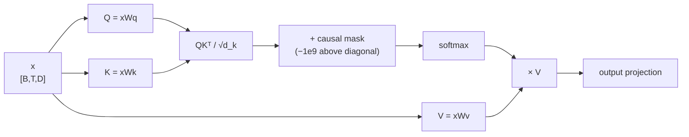

# MiniGPT Lab

A decoder-only Transformer built from scratch in TypeScript, with a workbench for training it, inspecting it and comparing runs.

No pretrained weights, no Python, no high-level model wrappers. Every component — token and positional embeddings, causal multi-head self-attention, pre-LayerNorm residual blocks, GELU, cross-entropy, AdamW with decoupled weight decay, cosine learning-rate decay with warmup — is implemented directly on TensorFlow.js tensor primitives and runs on a consumer CPU.

```bash
npm install
npm run dev          # backend on :3001, UI on :5173
```

---

## Table of contents

[TOC]

---

## What this is for

Three things, in order of how much they shape the design:

1. **Running experiments you can trust.** Every source of randomness is seeded — weight initialization, batch order, dropout masks, and sampling. Validation loss is measured on a *fixed* set of windows. Two runs with the same seed and config are bit-identical, so when you change one hyperparameter and the curve moves, the change caused it.
2. **Seeing the mechanism.** Attention maps per layer and head, the probability distribution behind every generated character, a live parameter breakdown, and a finite-difference check that proves backpropagation is correct.
3. **Reading the implementation.** Every file explains the *why*, not just the *what* — why the causal mask is additive and applied before softmax, why weight decay must be decoupled from Adam, why residual-path weights are initialized at `1/sqrt(2L)`.

> [!NOTE]
> This trains a model with a few hundred thousand parameters on about a megabyte of text. It will not produce good prose. It produces something that is unmistakably learning English structure, which is the point.

---

## Quick start

### Requirements

- Node.js 18+ (tested on 24)
- npm 9+
- ~2 GB free RAM

### Run

```bash
npm install
npm run dev
```

Then open <http://localhost:5173>.

If port 3001 is taken, both halves follow one variable:

```bash
PORT=3131 npm run dev
```

### A first experiment

1. Open **Inference** (key `2`) and generate from `ROMEO:`. The model is untrained, so you get noise — that is the correct starting point.
2. Open **Attention** (key `3`) and compute a map. It is nearly uniform across the lower triangle.
3. Open **Run** (key `1`) and press **Start training**. Watch loss fall away from the `ln(65) = 4.17` baseline drawn on the chart.
4. After a few hundred steps, revisit **Attention**. Structure has appeared, and different heads now disagree with each other.
5. Back in **Inference**, generate again and click individual characters to see what the model was considering.

---

## The interface

| View | Key | What it answers |
| :--- | :-: | :--- |
| **Run** | `1` | Is it learning? Is it about to break? How long? |
| **Inference** | `2` | What does it produce, and what was it considering at each step? |
| **Attention** | `3` | What is each token actually looking at? |
| **Architecture** | `4` | What do these hyperparameters do, and what do they cost? |
| **Data** | `5` | What is it training on, and how is the text tokenized? |
| **Checkpoints** | `6` | Saved weights, and resuming a run exactly. |
| **Experiments** | `7` | How do two runs compare, and what differed between them? |

`Space` starts and pauses. The status bar shows the **active TensorFlow backend** — see [Performance](#performance) for why that matters.

---

## Architecture

```mermaid
flowchart TB
    subgraph input [" "]
        T["Input tokens<br/>[batch, seqLen]"]
    end

    T --> TE["Token embedding<br/>[vocabSize, d_model]"]
    T --> PE["Position embedding<br/>[contextLength, d_model]"]
    TE --> ADD(("+"))
    PE --> ADD
    ADD --> DROP["Dropout"]

    DROP --> BLOCK

    subgraph BLOCK ["Transformer block × numLayers"]
        direction TB
        LN1["LayerNorm"] --> ATT["Causal multi-head<br/>self-attention"]
        ATT --> R1(("+"))
        R1 --> LN2["LayerNorm"]
        LN2 --> MLP["Linear → GELU → Linear"]
        MLP --> R2(("+"))
    end

    BLOCK --> LNF["Final LayerNorm"]
    LNF --> HEAD["LM head<br/>(tied to embedding)"]
    HEAD --> LOGITS["Logits<br/>[batch, seqLen, vocabSize]"]
    LOGITS --> LOSS["Softmax cross-entropy"]
    LOSS --> BP["Backprop → clip → AdamW"]

    style BLOCK fill:#11141b,stroke:#2a3140
```



The residual connections are drawn as the `+` nodes feeding forward past each sub-layer. That path — input added straight to the output, never normalized — is what lets gradients reach the first layer in a deep stack: the derivative of `x + f(x)` with respect to `x` is `1 + f'(x)`, so there is always a path of gradient 1 straight back.

### Attention, concretely



The mask is **additive and applied before softmax**. Adding `-1e9` to a score makes `exp(score)` underflow to exactly 0, so the disallowed positions receive zero probability mass and the remaining weights still sum to 1. Zeroing *after* softmax would leave the row summing to less than 1 and silently scale down the output.

---

## What makes runs comparable

This is the part that distinguishes an instrument from a demo.

### Everything is seeded

| Source of randomness | Seeded by |
| :--- | :--- |
| Weight initialization | `model.randomSeed` |
| Batch sampling order | `training.dataSeed` |
| Dropout masks | derived from `model.randomSeed` |
| Text sampling | `generation.seed` (optional) |

`Math.random()` and unseeded `tf.randomNormal` appear nowhere in the training path. The generator is mulberry32, which produces identical output on every platform and Node version.

Each weight tensor draws from a *derived* sub-stream keyed by its name, so adding a layer does not shift the random numbers used by the layers around it — a 3-layer and a 4-layer model share initial weights for the tensors they have in common.

### Validation batches are fixed

Evaluation uses a fixed set of evenly spaced windows, chosen once when the dataset loads. If validation were measured on fresh random batches, consecutive measurements would differ both because the model changed *and* because the data did, and real improvements would disappear into the noise.

### Splits are contiguous

The train/val/test split is a straight cut at 80% and 90% of the text, not a random assignment of windows. Random windows overlap — a training window ending at character 1000 and a validation window starting at 990 share ten characters — so validation would be partly measured on memorised text.

---

## The training recipe

| Technique | Why it is here |
| :--- | :--- |
| **Global-norm gradient clipping** | Scales all gradients by one shared factor when their combined norm exceeds the threshold. Preserves direction, caps magnitude. The single most effective guard against a loss spike to NaN. |
| **Cosine decay + linear warmup** | Large early steps to find a good region, small late steps to settle into it. Warmup exists because Adam's variance estimate is unreliable in the first few dozen steps. |
| **Decoupled weight decay (AdamW)** | Applied directly to the weights, not folded into the gradient — inside Adam, an L2 gradient term gets divided by the same running RMS it contributes to, so the effective decay rate varies per parameter. Biases and LayerNorm are exempt. |
| **Weight tying** | The embedding table and the output head are inverse views of the same vocabulary. Sharing one matrix saves `vocabSize × d_model` parameters and usually improves quality. |
| **GPT-2 residual scaling** | Layers writing into the residual stream are initialized at `std / sqrt(2 · numLayers)`, because every block adds to a running sum. Without it, activation variance grows with depth and deep configs destabilise. |
| **Dropout** | Active during training, disabled for evaluation and generation. On a 1 MB corpus, overfitting is the dominant failure mode. |
| **Divergence detection** | A run is aborted when loss exceeds a multiple of `ln(vocabSize)`. Checking only for NaN is not enough — a run can reach a loss of 1e13 with every number still a finite float32. |

> [!IMPORTANT]
> Training loss is measured **with dropout active**, so it reads worse than the model really is. Judge quality by validation loss, which is measured with dropout off.

---

## Verifying backpropagation

`npm run train -- --gradient-check` compares the analytic gradients against numerical finite differences:

```
  tensor                                       size     analytic      numeric    rel.err
  --------------------------------------------------------------------------------------
  token_embedding                             8320     1.071e+0     1.071e+0    8.42e-5
  layer_0_attn_w_q                           16384     1.284e-2     1.277e-2    5.61e-3
  ...
  --------------------------------------------------------------------------------------
  ALL PARAMETERS AT ONCE                                8.940e+0     8.938e+0    2.72e-4
```

Each tensor is perturbed **along its own gradient direction**, and the measured change in loss is compared against the gradient's L2 norm:

$$\frac{L(w + h v) - L(w - h v)}{2h} \approx |g|, \quad v = \frac{g}{|g|}$$

> [!WARNING]
> Perturbing a **single weight** does not work here, and this is worth understanding before trusting any gradient check. An individual gradient in this model is around `1e-6`, so it moves the loss by about `1e-9` — roughly 400× below the `2.4e-7` absolute resolution of a float32 loss near 3.2. The measurement would be pure rounding noise. Perturbing along the whole gradient direction concentrates the signal into a measurable range.

For the same reason, tolerance widens for tensors with small gradients: the numeric estimate carries a *fixed absolute* uncertainty, which is relatively larger when the true derivative is small. A genuinely wrong gradient — a sign flip, a transpose, a missing term — is wrong by order 100% and is caught regardless.

This runs from the UI too, on the **Architecture** tab.

---

## Scripts

| Command | Purpose |
| :--- | :--- |
| `npm run dev` | Backend and frontend together, with reload. |
| `npm run build` | Production build of both. |
| `npm start` | Serve the production build from the backend. |
| `npm test` | Full Vitest suite (93 tests). |
| `npm run test:watch` | Tests in watch mode. |
| `npm run train` | CLI training. See `--help` for flags. |
| `npm run train -- --gradient-check` | Verify backpropagation and exit. |
| `npm run typecheck` | `tsc --noEmit`. |

### CLI training

```bash
npm run train -- --steps 3000 --layers 6 --embed 192 --lr 0.002
npm run train -- --tokenizer word --sample-prompt "The "
npm run train -- --schedule constant --clip 0     # deliberately unstable
```

Every flag maps onto the same configuration object the UI edits, so a CLI run and a UI run with matching settings are the same run.

---

## Checkpoints

Checkpoints are written as binary `.mgpt` files:

```
bytes 0–3     magic "MGPT"
bytes 4–7     header length (uint32 LE)
bytes 8–N     UTF-8 JSON header: config, tokenizer vocab, step, metrics, variable directory
bytes N–end   tightly packed float32 weights
```

Three consequences:

- **They are ~9× smaller than the JSON equivalent.** A float32 occupies 4 bytes in memory but 8–20 ASCII bytes as a decimal string. The same model that produced an 86 MB JSON file writes a 9.7 MB `.mgpt`.
- **They are self-describing.** The header can be read without touching the weights, which is how the Checkpoints table lists architecture and loss for every file cheaply.
- **They carry the tokenizer vocabulary.** Token ID 42 means nothing unless you know which dataset built the mapping — loading a Shakespeare checkpoint against a Moby Dick vocabulary would produce fluent-looking garbage with no error. That combination is now refused.

Adam's moment estimates are stored too, so resuming restores momentum rather than restarting the optimizer from zero.

---

## Performance

> [!TIP]
> Check the **TensorFlow backend** shown in the status bar. It should say `tensorflow`. If it says `cpu`, the native binding failed to load and TF.js fell back to pure JavaScript — roughly **10× slower**, with no error message anywhere. That silent fallback is why the indicator exists.

Measured on an 11th-gen i5-1135G7 (8 logical cores, native backend), default config — 4 layers, `d_model` 128, context 64, batch 64, **810K parameters**:

| Metric | Value |
| :--- | ---: |
| Throughput | ~1,700 tok/s |
| Step time | ~1.4 s (2.4 s while also serving the UI) |
| Checkpoint size | 9.7 MB (`.mgpt`) vs 86 MB as JSON |

Validation loss over a real run on Tiny Shakespeare, 65-token vocabulary (baseline `ln 65 = 4.17`):

| Step | Val loss | Perplexity |
| ---: | ---: | ---: |
| 25 | 2.835 | 17.0 |
| 50 | 2.591 | 13.3 |
| 100 | 2.469 | 11.8 |
| 200 | 2.211 | 9.1 |
| 400 | 1.943 | 7.0 |
| 600 | 1.820 | 6.2 |

For comparison, the previous training recipe — fixed learning rate, no clipping, no warmup, no weight decay, no weight tying — plateaued around 2.50 after 500 steps. The same architecture now passes that at step 50.

What the model produces along the way:

| Step | Sample |
| ---: | :--- |
| 125 | `Ay me doue than, fuit be no thelusth be,` |
| 250 | `At meare, but heint the goode prustice.` |
| 425 | `Ay, in so do hath were bear the with cincesed,` |
| 475 | `Ay, he on come heaves be prave.` |

Attention cost grows as **O(T²)** in context length, so that is the most expensive dial. Going from 64 to 128 roughly quadruples attention compute.

> [!NOTE]
> The training loop and the HTTP server share one process and one event loop. A training step runs as a single synchronous TensorFlow call, so the API yields only between steps — during training, a request can wait up to one step time before being served. That is why the step time above is higher with the UI open. Moving training to a worker thread would remove it, at the cost of a considerably more complex architecture than this project warrants.

---

## Testing

```bash
npm test
```

93 tests across three files:

- **`numerics.test.ts`** — GELU, LayerNorm, softmax and the linear projections against hand-derived values, not against whatever the code currently returns. Includes softmax overflow at `exp(1000)` and the transposed-linear equivalence that makes weight tying valid.
- **`model.test.ts`** — the gradient check; an overfit-a-tiny-batch test; a behavioural causal-mask proof (changing a *future* token must not alter earlier logits); checkpoint round-trip equality on *logits*, not just weights; a tensor-leak check; and a regression test for the optimizer-state bug described below.
- **`dataset.test.ts`** — tokenization, split integrity, batch shifting, and reproducibility of the seeded RNG.

A few tests worth calling out:

**The causal-mask test is behavioural.** Inspecting the mask tensor only proves it was *built* correctly. Changing token 3 and asserting that the logits at positions 0–2 are bit-identical proves it was *wired in* correctly — a mask applied at the wrong point passes the first test and fails this one. If it fails, the model is reading the answer it is being asked to predict, and every loss number it reports is meaningless.

**The overfit test** drives loss near zero on a tiny repeated corpus. Almost every training-loop bug — a detached gradient, an optimizer that never applies, a loss on the wrong axis — shows up here.

**The verification test is itself verified.** One case asserts that the gradient check *fails* under an impossible tolerance, so a check that always passed could not masquerade as a proof.

---

## Project layout

```
src/
├── backend/
│   ├── core/
│   │   ├── rng.ts                 # Seeded mulberry32 + Box-Muller normals
│   │   └── init.ts                # Weight init, incl. GPT-2 residual scaling
│   ├── dataset/
│   │   ├── datasetManager.ts      # Splits, seeded batching, fixed eval windows
│   │   ├── tokenizer.ts           # Character-level
│   │   ├── wordTokenizer.ts       # Word-level
│   │   └── types.ts               # Shared tokenizer contract
│   ├── model/
│   │   ├── layers.ts              # GELU, LayerNorm, softmax, dropout, linear
│   │   ├── attention.ts           # Causal MHSA, cached masks, weight capture
│   │   ├── transformerBlock.ts    # Pre-LN block with residuals
│   │   ├── gpt.ts                 # Full model, .mgpt persistence
│   │   └── generation.ts          # Sampling, streaming, attention snapshots
│   ├── training/
│   │   ├── engine.ts              # Training loop, eval, gradient check
│   │   ├── schedule.ts            # Warmup + cosine/linear decay
│   │   ├── optimizer.ts           # Global-norm clipping, decoupled decay
│   │   └── cliTrain.ts            # Command-line runner
│   └── api/
│       ├── server.ts              # REST + WebSocket
│       └── validation.ts          # Zod schemas, path safety, host allowlist
├── frontend/
│   ├── lib/                       # API client, store, formatting
│   ├── components/                # UI primitives and charts
│   └── views/                     # One file per tab
└── shared/
    ├── config/                    # Defaults and parameter documentation
    └── types/                     # Interfaces shared across the boundary
```

---

## Security

This binds to localhost, but "localhost only" is not a boundary: any web page you have open can issue a cross-origin POST to `http://localhost:3001`. The handlers are written accordingly.

- **Path traversal is closed on both sides.** `name` and `fileName` from a request body are reduced to their base name *and* the resolved path is verified to remain inside its directory. Either check alone would do; both are present because this is the kind of code that gets refactored by someone who does not know why it was written.
- **`POST /api/dataset/url` uses a host allowlist.** Unrestricted, it is a readable SSRF primitive — the server would fetch any URL the caller chose, including `169.254.169.254` on a cloud host, and write the response to disk.
- **CORS is restricted to loopback origins**, matched on exact hostname. `startsWith('localhost')` would also accept `localhost.evil.com`.
- **Every request body is validated** against a Zod schema before anything downstream sees it, so a bad value becomes a 400 naming the field rather than a crash several seconds into training.

---

## Notable bugs found and fixed

Recorded because each one is instructive, and each now has a regression test.

**Gradients were computed for every registered variable.** `optimizer.minimize()` was called without a variable list, so TF.js differentiated with respect to *all* trainable variables in its global environment — including those of orphaned model instances left behind by a config change or a checkpoint load. Those models were silently receiving Adam updates.

**Disposing the optimizer's live state.** `optimizer.getWeights()` returns Adam's *live* internal moment tensors, not copies. Saving them and then disposing them — the obvious reading of the API — destroyed the optimizer mid-run, and the next step failed with `Cannot read properties of undefined (reading 'backend')`, an error pointing nowhere near the cause. The fix is to clone before saving and dispose the clones.

**Top-K kept more than K on ties.** The filter tested `< cutoff`, which retains every token *equal* to the cutoff. With a near-untrained model — whose logits are nearly identical — this meant top-K did nothing at all, in exactly the state a new user generates in first.

**The probability inspector dropped the chosen token.** It reported the top 8 candidates, but with a flat distribution the sampled token frequently is not among them, so the UI showed a list with nothing marked as chosen.

**`reset` kept the trained weights.** It cleared the step counter but not the model, so "reset, then train" silently continued from a partially trained model while reporting step 1 — invalidating any comparison against a fresh run.

**Divergence detection only checked for NaN.** A run reached a loss of 1.8e13 — trillions of times the uniform-guessing baseline — with every value a perfectly finite float32, and training continued for the remaining steps.

**`dropoutRate` and `randomSeed` were configuration fiction.** Both appeared in the types and the UI; neither was referenced anywhere in the model.

---

## License

MIT
